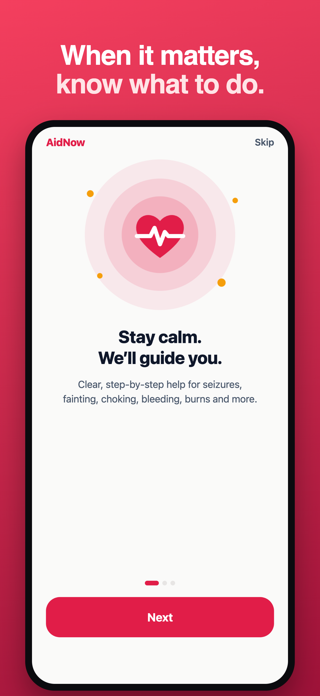
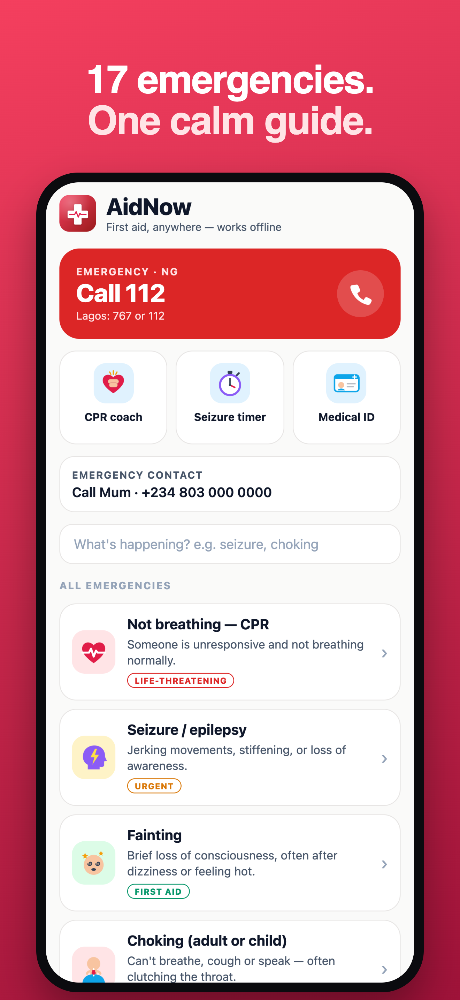
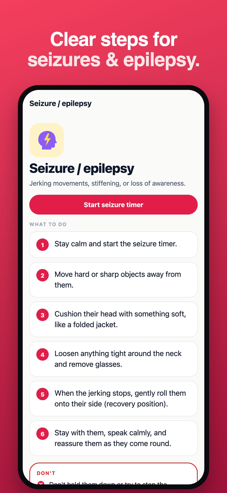
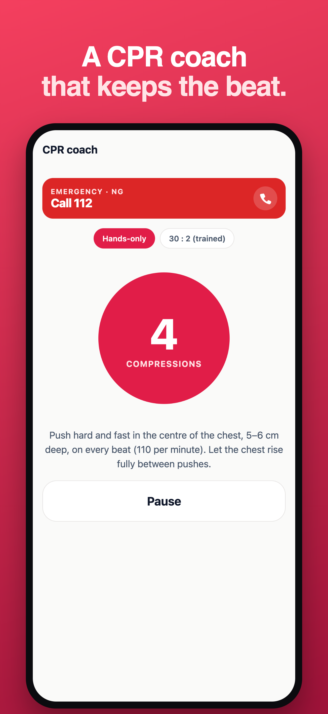

# AidNow

> Know what to do in an emergency, wherever you are.

<p align="center">
  
  
  
  
</p>

## What's built

- Quick **onboarding** (3 slides, skippable) on first launch
- Country-aware **emergency call button** (112 / 911 / 999 … from the device region; Nigeria → 112, Lagos 767 noted)
- **17 offline first-aid guides**, each with its own illustration: CPR, seizures/epilepsy, fainting, choking (adult & baby), severe bleeding, burns, anaphylaxis, asthma, stroke (FAST), heart attack, heat stroke, low blood sugar, recovery position, nosebleed, fractures, poisoning — with steps, don'ts, and "call emergency if"
- **Seizure timer** that alerts at 5 minutes and keeps a log to share with a doctor
- **CPR coach**: 110 bpm metronome with haptics, hands-only or 30:2 mode
- **Medical ID** (allergies, conditions, medications, emergency contact) with one-tap call

## Before release

- Have **all guide content reviewed by a qualified clinician** and localised (Yoruba, Hausa, Igbo, Pidgin…).
- Verify emergency numbers for every launch market (`src/data/emergency-numbers.ts`).
- Ideas: share live location by SMS, lock-screen Medical ID, illustrated steps, voice guidance.

## Tests

```bash
npm test          # Jest + jest-expo + React Native Testing Library
```

41 tests cover guide completeness and safety rules (e.g. every life-threatening guide says when to call, no abdominal thrusts for babies), emergency numbers by country, onboarding, search, placing a call, opening guides, saving a Medical ID, the 5-minute seizure alert and the CPR rate.

Illustrations are original and generated by `tool/make-art.py` (render with `tool/render-art.mjs`).

## Run it

```bash
npm install          # already done once after scaffolding
npx expo start       # then press i (iOS), a (Android) or w (web)
npm run typecheck
npx expo lint
```

Built on **Expo SDK 58** (React Native 0.88, React 19.3), Expo Router, TypeScript.
Everything is stored on-device with AsyncStorage (`src/lib/storage.ts`); there is no backend yet.

## Structure

- `src/app/` — screens (Expo Router; every file is a route)
- `src/brand.ts` — app name, brand colours, screen titles
- `src/theme.ts` — light/dark design tokens
- `src/components/ui.tsx` — shared UI primitives
