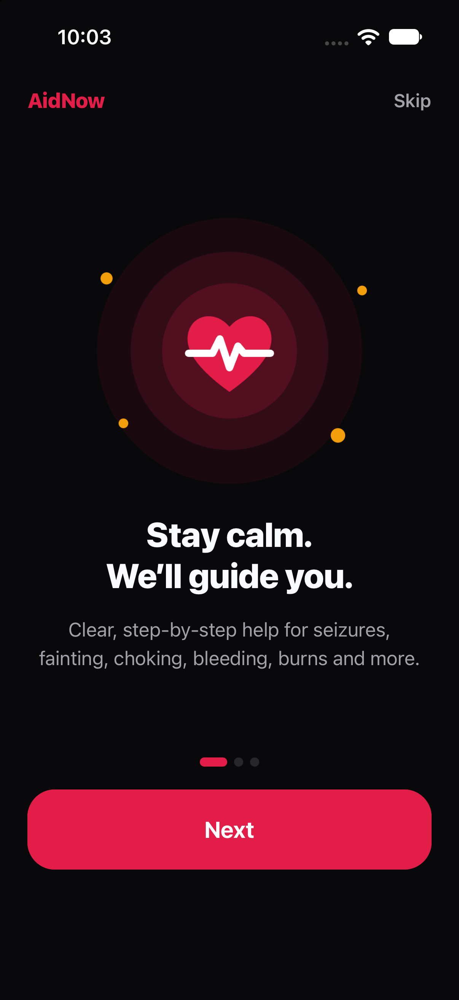
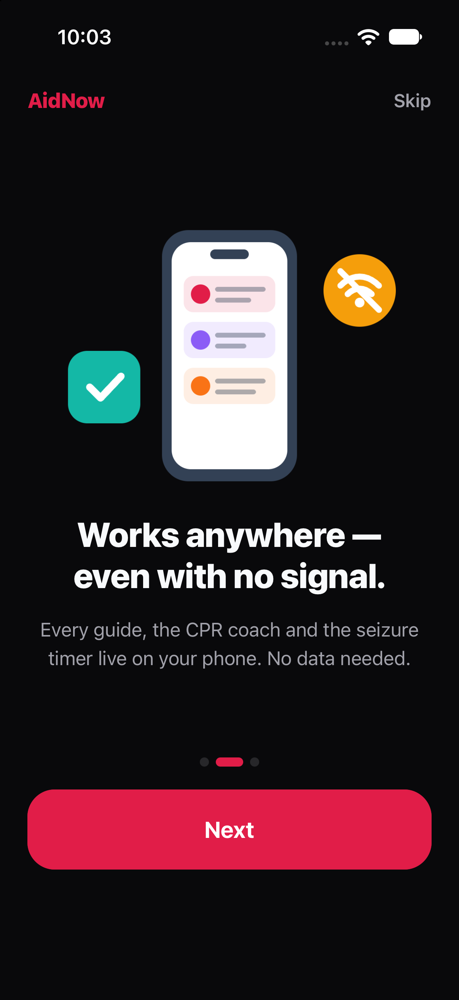
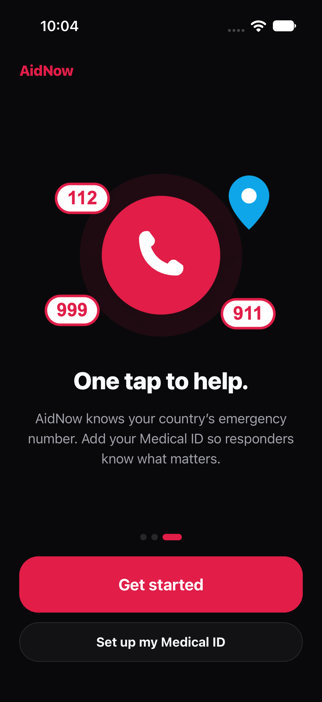
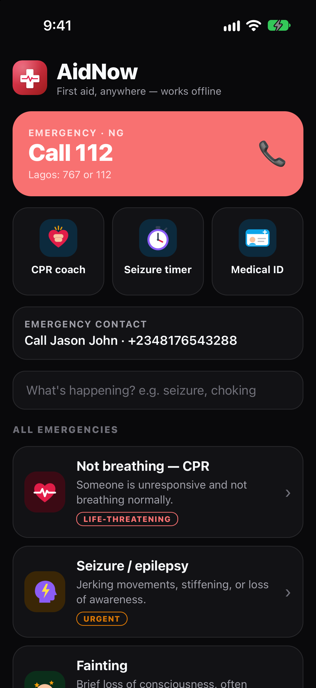
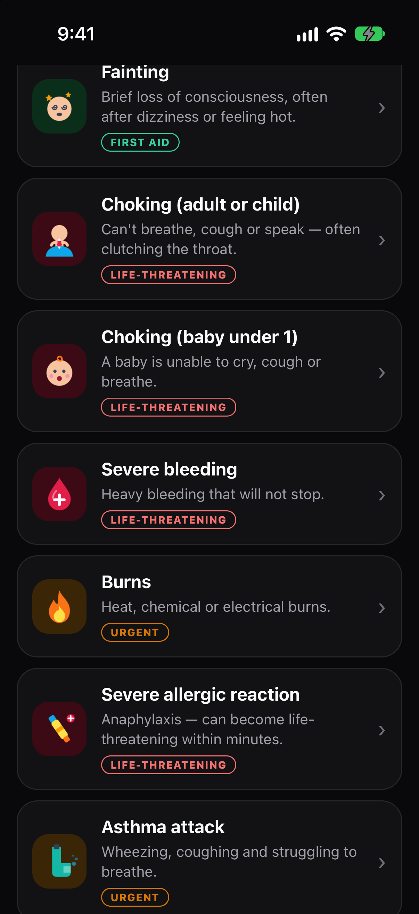
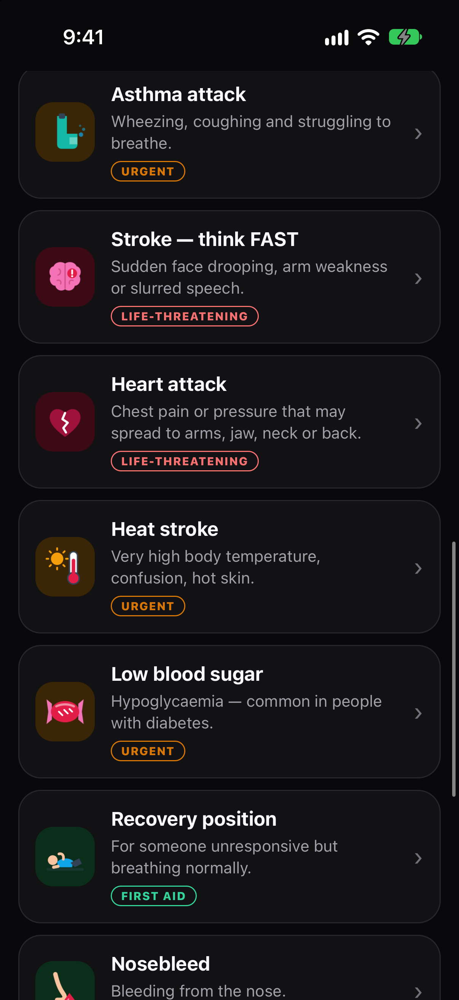
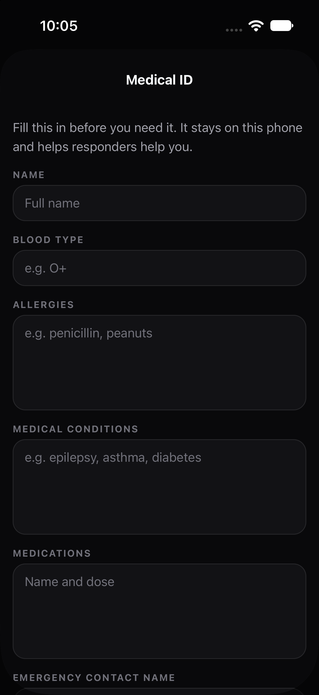
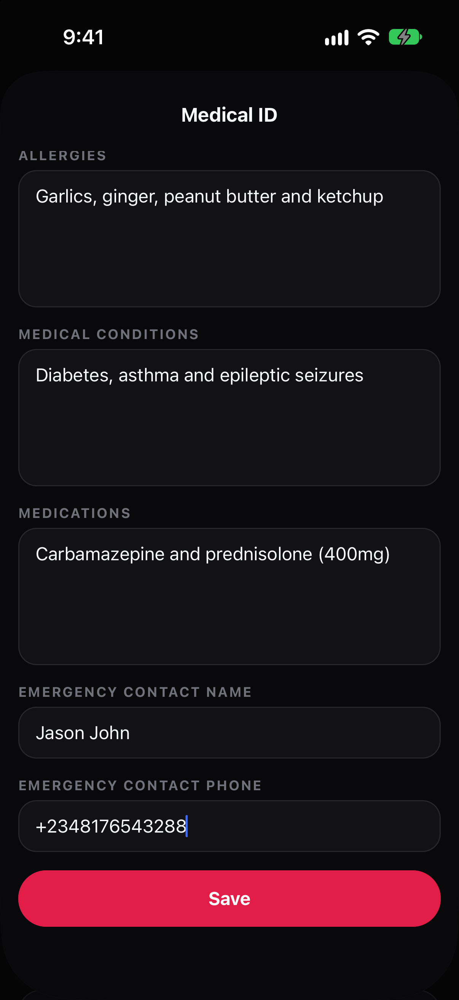
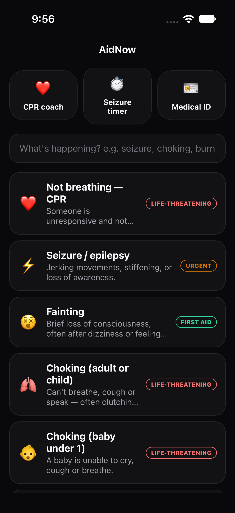

<p align="center">
  
</p>

<h1 align="center">AidNow</h1>

<p align="center">
  <strong>Know what to do in an emergency, wherever you are.</strong><br />
  Offline-first first aid for seizures, fainting, choking, CPR, bleeding, burns and more.
</p>

<p align="center">
  
  
  
  
  
</p>

<p align="center">
  
  
  
  
</p>

---

## Why AidNow

In an emergency most people freeze. First-aid knowledge is scattered, rarely remembered, and often unreachable when there's no signal. AidNow puts calm, step-by-step help in your pocket — big, readable steps, one tap to the right emergency number for the country you're in, and tools that do the counting for you while your hands are busy.

## Features

| | |
|---|---|
| **One-tap emergency call** | Uses your phone's region to dial the right number — 112 in Nigeria (with Lagos's 767 noted), 911, 999, 000, 119 and more. Falls back to 112, which works on GSM networks almost everywhere. |
| **17 illustrated guides** | CPR · Seizure / epilepsy · Fainting · Choking (adult & child) · Choking (baby under 1) · Severe bleeding · Burns · Severe allergic reaction · Asthma attack · Stroke (FAST) · Heart attack · Heat stroke · Low blood sugar · Recovery position · Nosebleed · Broken bone or sprain · Poisoning. Each has numbered steps, a **Don't** list and **Call emergency if…** |
| **Seizure timer** | Times a seizure, vibrates and turns red at 5 minutes with a call button, and keeps a log to show a doctor. |
| **CPR coach** | A 110 bpm metronome with a pulsing visual and haptic beat — hands-only or 30 : 2 for trained rescuers. |
| **Medical ID** | Blood type, allergies, conditions, medications and an emergency contact — stored only on the phone, with one-tap calling from the home screen. |
| **Search** | Type what's happening ("fit", "burn", "can't breathe") and the right guide comes up. |
| **Onboarding** | Three quick, skippable slides on first launch. |
| **Offline by design** | Every guide, tool and illustration ships inside the app. No account, no network needed. |

## Screens

<table>
  <tr>
    <td align="center"><br /><sub>Onboarding · Stay calm</sub></td>
    <td align="center"><br /><sub>Onboarding · Offline</sub></td>
    <td align="center"><br /><sub>Onboarding · One tap</sub></td>
    <td align="center"><br /><sub>Home</sub></td>
  </tr>
  <tr>
    <td align="center"><br /><sub>All emergencies</sub></td>
    <td align="center"><br /><sub>All emergencies (cont.)</sub></td>
    <td align="center"><br /><sub>Medical ID</sub></td>
    <td align="center"><br /><sub>Medical ID · contact</sub></td>
  </tr>
</table>

<details>
<summary><strong>Before → after</strong> (the iOS header fix)</summary>
<br />
<p>
  
  &nbsp;→&nbsp;
  
</p>
The native iOS large-title header rendered as a blank block over the content because the scroll view wasn't the screen's direct child. AidNow now draws its own header inside the safe area.
</details>

## Safety notice

AidNow gives **general first-aid guidance** based on widely published lay-rescuer advice (Red Cross / St John Ambulance / AHA style). It is **not** a medical device and **not** a substitute for professional care or a first-aid course. In an emergency, always call your local emergency number first.

Before a public release, all guide content must be reviewed by a qualified clinician and localised (Yorùbá, Hausa, Igbo, Pidgin…), and the emergency numbers verified for every launch market.

## Tech stack

- **Expo SDK 58** · React Native 0.88 · React 19.3 · **TypeScript** (strict) · **Expo Router**
- `expo-haptics` (CPR beat, alerts) · `expo-localization` (country → emergency number) · `expo-image`
- `@react-native-async-storage/async-storage` with a small synced-state hook (`src/lib/storage.ts`)
- **Jest** + `jest-expo` + **React Native Testing Library**

## Project structure

```
src/
  app/                 screens (Expo Router — every file is a route)
    index.tsx          home: call button, tools, search, all guides
    onboarding.tsx     first-launch slides
    guide/[id].tsx     a single guide
    cpr.tsx            CPR coach
    seizure-timer.tsx  seizure timer + log
    medical-id.tsx     Medical ID form
  components/          call button, illustrated tiles, shared UI
  data/                guides, emergency numbers, illustration map
  lib/                 storage, emergency helpers, brand types
assets/aid/            illustrations (@3x PNG)
tool/                  make-art.py + render-art.mjs (regenerate illustrations)
__tests__/             Jest suites
docs/screenshots/      store/, ios/, before/
```

## Getting started

```bash
npm install
npx expo start          # press i for the iOS Simulator, a for Android
```

### Tests

```bash
npm test                # 41 tests
npx tsc --noEmit        # typecheck
npx expo lint           # lint
```

The suites cover guide completeness and **safety rules** (every life-threatening guide says when to call; no abdominal thrusts for babies; the seizure guide's don'ts), emergency numbers by country, and real user flows through the screens: onboarding and skip, search, placing a call, opening a guide, saving a Medical ID, the 5-minute seizure alert and the CPR rate.

### Regenerating the illustrations

```bash
python3 tool/make-art.py
node tool/render-art.mjs <path-to-puppeteer-core> /tmp/contact-sheet.png
```

### Building an APK (coming next)

```bash
npx eas-cli@latest build --platform android --profile preview
```

## Roadmap

- [ ] Clinician review and localisation (Yorùbá, Hausa, Igbo, Pidgin)
- [ ] Share live location with emergency contacts by SMS
- [ ] Lock-screen Medical ID
- [ ] Illustrated / animated step-by-step visuals and voice guidance
- [ ] Android preview build (EAS) and TestFlight

## Author

Built by **Olateju Olamide Emmanuel** — mobile developer & ML engineer.
[Portfolio](https://tejusportfolio.vercel.app) · [GitHub](https://github.com/tejHacks) · [LinkedIn](https://www.linkedin.com/in/olateju-olamide-22314a292/)

## License

MIT — see [LICENSE](LICENSE).
